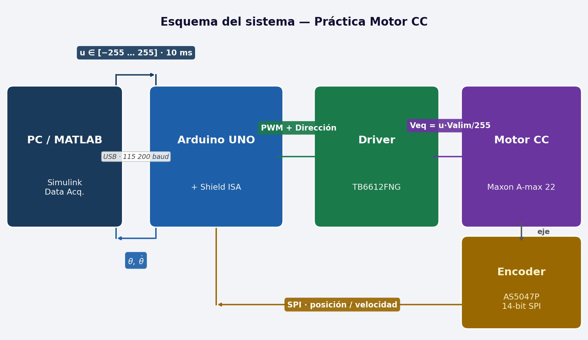

# Motor CC — Equipo de Prácticas de Control / DC Motor Control Lab

<p align="center">
  
</p>

<p align="center">
  <a href="#español">🇪🇸 Español</a> &nbsp;|&nbsp;
  <a href="#english">🇬🇧 English</a>
</p>

---

## Español

### Descripción del sistema

Este repositorio contiene todo el material necesario para montar y utilizar el **equipo de prácticas de control de un motor de corriente continua** desarrollado en el Departamento de Ingeniería de Sistemas y Automática de la Universidad de Sevilla (ISA).

> **¿Por qué este equipo?**  
> No todos los equipos de laboratorio son iguales. Este se ha diseñado desde cero eligiendo los mejores componentes disponibles para cada función: un encoder magnético sin contacto de **14 bits**, un motor **Maxon** de precisión aeroespacial y un protocolo de comunicaciones propio que hace que conectar MATLAB/Simulink sea cuestión de minutos. El resultado es una plataforma donde la señal habla por sí sola — sin ruido artificial, sin fricciones parásitas, sin restricciones de toolboxes — y en la que el estudiante puede centrarse en el control, no en la electrónica.

El equipo destaca en cuatro aspectos clave:

- 🎯 **Alta resolución, señal limpia, sin fricción.** El encoder magnético **ams AS5047P** ofrece **14 bits de resolución** (16 384 pasos/vuelta). La medida de posición angular es extremadamente limpia, con un nivel de ruido prácticamente inapreciable. La velocidad se obtiene por derivación numérica de la posición, por lo que sí presenta algo más de ruido — fácilmente tratable con un filtro en MATLAB. Todo esto sin introducir ningún tipo de fricción en el eje, a diferencia de los encoders ópticos de contacto.

- ⚙️ **Motor de calidad profesional.** El motor **Maxon A-max 22** es un motor DC de precisión con reductora planetaria, del mismo fabricante utilizado en robótica y aplicaciones aeroespaciales, lo que garantiza un comportamiento dinámico limpio y repetible ideal para identificación y control.

- 🔌 **Plug & play desde MATLAB/Simulink.** Gracias al protocolo de comunicaciones binario desarrollado a medida y a la **placa shield diseñada a medida** ([`hardware/pcb/`](hardware/pcb/)) que integra el driver TB6612FNG y el conector del encoder en un único módulo apilable sobre el Arduino, el modelo de Simulink prácticamente se reduce a **un único bloque** para cerrar el bucle de control. Solo hay que configurar el puerto serie — sin cables volantes, sin electrónica adicional.

- 📦 **Dependencia mínima de toolboxes.** La única librería de MATLAB necesaria es el **Instrument Control Toolbox** — no se requieren toolboxes adicionales de Control System, Simulink Real-Time ni similares.

### Componentes del sistema

| Componente | Modelo | Descripción |
|---|---|---|
| Motor | Maxon A-max 22 (Art. 110120) | Motor CC con reductora GP 22 B (Art. 110356) |
| Driver | Toshiba TB6612FNG | Driver dual de motor, 1.2 A cont. / 3 A pico |
| Encoder | ams AS5047P | Encoder magnético 14 bits, lado de carga |
| Microcontrolador | Arduino (Uno / Mega) | Adquisición y protocolo de comunicaciones |
| Software de control | MATLAB / Simulink | Cálculo de la acción de control en PC |
| Estructura | PLA (impresión 3D) | Bancada y soportes fabricados en casa |

### Esquema del sistema

<p align="center">
  
</p>

### Montaje

### Lista de materiales para el montaje

| Cant. | Referencia | Descripción |
|:---:|---|---|
| 1 | Maxon A-max 22 (Art. 110120) + GP 22 B (Art. 110356) | Motor CC con reductora (imán de encoder incluido en el kit) |
| 1 | ams AS5047P | Encoder magnético 14 bits |
| 1 | Arduino UNO | Microcontrolador |
| 1 | Shield ISA (PCB a medida) | Placa con driver TB6612FNG e interfaz de encoder |
| 1 | Cable USB tipo B | Comunicación Arduino–PC |
| — | Piezas 3D en PLA | Bancada, soporte del motor y tapa del encoder (ver `hardware/3d-printing/`) |
| 4 | Pata de goma atornillada | Antivibraciones en la base; tamaño según orificio de la base |
| 12 | Tornillos M3×12 | Fijación de la bancada a la base y del motor al soporte *(los mismos valdrán con insertos metálicos)* |
| 4 | Tornillos M2×10 | Fijación del encoder y tapa |
| 1 | Cable JST (encoder ↔ shield) | Incluido con la shield o fabricado a medida |
| *(opcional)* | Batería 9 V con conector de barril | Alimentación externa (máx. 9 V, recomendado 8,4 V) |

> Los tornillos M3 e M2, las patas de goma y los cables JST son los únicos consumibles que hay que tener a mano antes de empezar el montaje.

El montaje del equipo es sencillo y no requiere herramientas especiales:

1. **Imprime las piezas 3D** — encontrarás los archivos STL en [`hardware/3d-printing/`](hardware/3d-printing/). Se recomienda PLA a un 20–30 % de relleno.
2. **Monta la bancada** — fija el motor a su soporte y atornilla el soporte a la base.
3. **Coloca el encoder** — el AS5047P se monta en el extremo del eje de salida de la reductora. Ajusta el entrehierro al valor indicado en el datasheet (~0,5–3 mm).
4. **Ensambla la electrónica** — apila la shield ISA sobre el Arduino y conecta los cables del motor (2 hilos de potencia) y del encoder (conector JST en la shield).
5. **Conecta a PC** — cable USB Arduino → PC. No se necesita alimentación externa para funcionar vía USB (rango dinámico reducido); para alimentación de batería conecta el conector de barril.

### Futuras mejoras

- 🔩 **Insertos metálicos roscados** — los orificios de tornillo actuales son directamente en PLA. Instalar insertos de latón (tipo M3 de calor) mejoraría notablemente la durabilidad del montaje y el apriete, y se pueden colocar en un plis-plas con un soldador.
- 📎 **Guías de cables en la base** — añadir unas pequeñas piezas de plástico (clips o canales) en la parte inferior de la base para fijar y ordenar los cables que van del motor al driver, evitando que queden sueltos y que puedan engancharse o deteriorarse.


### Estructura del repositorio

```
Motor-CC-Control-Lab/
├── firmware/
│   └── arduino/          # Código Arduino: protocolo serie + lectura encoder + PWM
├── software/
│   └── matlab/           # Modelo Simulink MotorCC_V3.slx (Instrument Control Toolbox)
├── hardware/
│   ├── 3d-printing/      # Archivos STL para imprimir las piezas
│   └── pcb/              # Esquemáticos y layout de la placa de circuito impreso
├── datasheets/
│   ├── motor/            # Datasheet del motor Maxon
│   ├── encoder/          # Datasheet AS5047P
│   └── driver/           # Datasheet del driver
├── docs/                 # Documentación, fotos, manual de usuario
└── labs/                 # Guiones de prácticas
    ├── lab01/
    ├── lab02/
    └── lab03/
```

### Requisitos

- **Hardware:** Ver tabla de componentes más arriba en este README
- **Software:** MATLAB R2020b o superior, Arduino IDE 2.x
- **Librerías Arduino:** `SPI.h` (incluida en el IDE)

### Cómo empezar

1. Clona el repositorio:
   ```bash
   git clone https://github.com/DocMuerde/Motor-CC-Control-Lab.git
   ```
2. Imprime las piezas 3D → [`hardware/3d-printing/`](hardware/3d-printing/)
3. Fabrica o monta la placa → [`hardware/pcb/`](hardware/pcb/)
4. Carga el firmware en Arduino → [`firmware/arduino/`](firmware/arduino/)
5. Abre `MotorCC_V3.slx` en Simulink → [`software/matlab/`](software/matlab/), haz doble clic en el bloque `Motor_CC`, selecciona el puerto serie del Arduino y pulsa Run
6. Realiza las prácticas → [`labs/`](labs/)

### Licencia

Este proyecto se distribuye bajo licencia **Creative Commons Attribution-ShareAlike 4.0** (CC BY-SA 4.0).

### Créditos

Desarrollado en el **Departamento de Ingeniería de Sistemas y Automática (ISA)**  
Universidad de Sevilla — Departamento de Ingeniería de Sistemas y Automática  
Contacto: [ialvarado@us.es](mailto:ialvarado@us.es)

---

## English

### System Description

This repository contains all the material needed to assemble and use the **DC motor control lab setup** developed at the University of Seville (ISA).

> **Why this rig?**  
> Not all lab setups are created equal. This one was designed from scratch with the best available component for each job: a **14-bit** contactless magnetic encoder, an aerospace-grade **Maxon** precision motor, and a custom communication protocol that gets MATLAB/Simulink running in minutes. The result is a platform where the signals speak for themselves — no artificial noise, no parasitic friction, no toolbox dependencies — allowing students to focus on control design, not wiring.

The rig stands out in four key areas:

- 🎯 **High resolution, clean signal, zero friction.** The **ams AS5047P** magnetic encoder delivers **14-bit resolution** (16 384 steps/rev). The angular position signal is exceptionally clean, with virtually no measurable noise. Velocity is obtained by numerical differentiation of position, so it carries somewhat more noise — easily handled with a filter in MATLAB. All of this with zero mechanical friction on the shaft, unlike contact optical encoders.

- ⚙️ **Professional-grade motor.** The **Maxon A-max 22** is a precision DC motor with planetary gearbox from the same manufacturer used in robotics and aerospace applications, ensuring clean, repeatable dynamics ideal for system identification and control experiments.

- 🔌 **Plug & play from MATLAB/Simulink.** Thanks to the custom binary serial protocol and the **custom shield** ([`hardware/pcb/`](hardware/pcb/)) that integrates the TB6612FNG driver and encoder connector in a single stackable module, the Simulink model is essentially **a single block** to close the control loop. Just configure the serial port — no loose wires, no extra electronics.

- 📦 **Minimal toolbox dependency.** The only MATLAB toolbox required is the **Instrument Control Toolbox** — no Control System Toolbox, Simulink Real-Time or other add-ons needed.

### System Components

| Component | Model | Description |
|---|---|---|
| Motor | Maxon A-max 22 (Art. 110120) | DC motor with GP 22 B gearbox (Art. 110356) |
| Driver | Toshiba TB6612FNG | Dual motor driver, 1.2 A cont. / 3 A peak |
| Encoder | ams AS5047P | 14-bit magnetic encoder, load side |
| Microcontroller | Arduino (Uno / Mega) | Data acquisition and comm. protocol |
| Control software | MATLAB / Simulink | Control law computation on PC |
| Structure | PLA (3D printed) | Bench and supports, in-house fabricated |

### Getting Started

1. Clone the repository:
   ```bash
   git clone https://github.com/DocMuerde/Motor-CC-Control-Lab.git
   ```
2. Print the 3D parts → [`hardware/3d-printing/`](hardware/3d-printing/)
3. Build or assemble the PCB → [`hardware/pcb/`](hardware/pcb/)
4. Upload the firmware to Arduino → [`firmware/arduino/`](firmware/arduino/)
5. Open `MotorCC_V3.slx` in Simulink → [`software/matlab/`](software/matlab/), double-click the `Motor_CC` block, select the Arduino serial port and press Run
6. Follow the lab sessions → [`labs/`](labs/)

### Assembly

### Bill of Materials

| Qty | Reference | Description |
|:---:|---|---|
| 1 | Maxon A-max 22 (Art. 110120) + GP 22 B (Art. 110356) | DC motor with gearbox (encoder magnet included in kit) |
| 1 | ams AS5047P | 14-bit magnetic encoder |
| 1 | Arduino UNO | Microcontroller |
| 1 | ISA Shield (custom PCB) | Board with TB6612FNG driver and encoder interface |
| 1 | USB Type-B cable | Arduino–PC communication |
| — | PLA 3D-printed parts | Bench, motor bracket and encoder cap (see `hardware/3d-printing/`) |
| 4 | Screwed rubber feet | Vibration damping for the base |
| 12 | M3×12 screws | Mounting bench to base and motor to bracket *(same screws will be reused with heat-set inserts)* |
| 4 | M2×10 screws | Encoder and cap fastening |
| 1 | JST cable (encoder ↔ shield) | Supplied with the shield or custom-made |
| *(optional)* | 9 V battery with barrel jack | External power (max 9 V, recommended 8.4 V) |

> M3/M2 screws, rubber feet and JST cables are the only consumables you need to have on hand before assembly.

Assembly is straightforward and requires no special tools:

1. **Print the 3D parts** — STL files are in [`hardware/3d-printing/`](hardware/3d-printing/). Recommended: PLA, 20–30 % infill.
2. **Mount the bench** — attach the motor to its bracket and screw the bracket to the base plate.
3. **Install the encoder** — the AS5047P mounts at the gearbox output shaft end. Set the air gap to the value in the datasheet (~0.5–3 mm).
4. **Assemble the electronics** — stack the ISA shield on the Arduino and connect the motor cables (2 power wires) and encoder (JST connector on the shield).
5. **Connect to PC** — USB cable Arduino → PC. USB power alone is enough (reduced dynamic range); for battery power connect the barrel jack.

### Future Improvements

- 🔩 **Metal threaded inserts** — current screw holes are tapped directly in PLA. Installing brass heat-set inserts (M3) would greatly improve durability and clamping force, and can be fitted in minutes with a soldering iron.
- 📎 **Cable management clips on the base** — small plastic clips or channels on the underside of the base to route and secure the cables running from the motor to the driver, preventing them from coming loose or getting damaged.


### License

CC BY-SA 4.0 — See [LICENSE](LICENSE) for details.

### Credits

**Systems Engineering and Automation Department (ISA)**  
University of Seville — Contact: [ialvarado@us.es](mailto:ialvarado@us.es)

---

## 🗂 Estado del proyecto y próximos pasos

> *Esta sección es un resumen de trabajo para retomar la sesión con Claude.*

### ✅ Completado (nov 2026)

- Firmware Arduino (`firmware/arduino/main/main.ino`): Ts = 10 ms (100 Hz), protocolo serie binario, observador de Luenberger (desactivado, listo para activar).
- Modelo Simulink (`software/matlab/MotorCC_V3.slx`): detección automática de puerto serie, bloque único para cerrar el lazo.
- Guía de prácticas **Lab 01** (`labs/lab01/lab01_isa.tex/.pdf`): descripción del equipo, lectura del encoder, medida de velocidad, identificación por escalón.
- Guía de prácticas **Lab 02** (`labs/lab02/lab02_isa.tex/.pdf`): zona muerta, control de velocidad (P → PI), control de posición (PD → PID).
- Todo el repositorio renombrado de GEPOC → **ISA**.

### 🔜 Pendiente

1. **Revisar y ajustar las guías de prácticas con el equipo real** — los parámetros del modelo (K ≈ 3, τ ≈ 0.07 s a 12 V) y los valores de las ganancias de los controladores deben verificarse experimentalmente y ajustarse si es necesario antes de pasárselas a los alumnos.
2. **Crear los boletines de soluciones** (Lab 01 y Lab 02) — una vez hechos los experimentos reales.
3. **Exportar el modelo Simulink a versiones anteriores** (`Simulink.exportToVersion`) para compatibilidad con MATLAB R2020b–R2024b por si los alumnos no tienen la última versión.
4. **Lab 03** (opcional) — práctica avanzada (control en cascada, estimación de estado, etc.) si se quiere ampliar el material.

### 💬 Cómo retomar con Claude

Abre una sesión nueva, comparte este repositorio y di algo como:

> *"Tengo un equipo de prácticas de control de motor CC. El repositorio está en GitHub: `https://github.com/DocMuerde/Motor-CC-Control-Lab`. Lee el README para ver el estado del proyecto y retomamos desde los puntos pendientes."*

