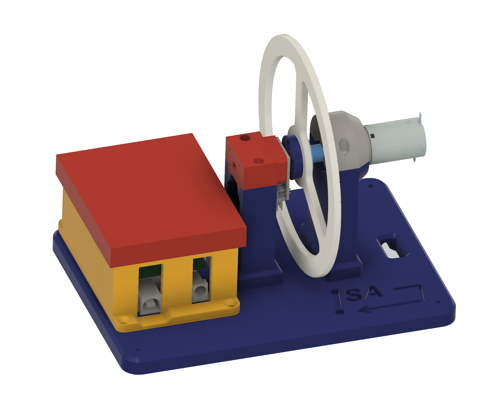

# Motor CC — Equipo de Prácticas de Control / DC Motor Control Lab

<p align="center">
  
</p>

<p align="center">
  <a href="#español">🇪🇸 Español</a> &nbsp;|&nbsp;
  <a href="#english">🇬🇧 English</a>
</p>

---

## Español

### Descripción del sistema

Este repositorio contiene todo el material necesario para montar y utilizar el **equipo de prácticas de control de un motor de corriente continua** desarrollado en el Departamento de Ingeniería de Sistemas y Automática de la Universidad de Sevilla (GEPOC).

> **¿Por qué este equipo?**  
> No todos los equipos de laboratorio son iguales. Este se ha diseñado desde cero eligiendo los mejores componentes disponibles para cada función: un encoder magnético sin contacto de **14 bits**, un motor **Maxon** de precisión aeroespacial y un protocolo de comunicaciones propio que hace que conectar MATLAB/Simulink sea cuestión de minutos. El resultado es una plataforma donde la señal habla por sí sola — sin ruido artificial, sin fricciones parásitas, sin restricciones de toolboxes — y en la que el estudiante puede centrarse en el control, no en la electrónica.

El equipo destaca en cuatro aspectos clave:

- 🎯 **Alta resolución, señal limpia, sin fricción.** El encoder magnético **ams AS5047P** ofrece **14 bits de resolución** (16 384 pasos/vuelta). La medida de posición angular es extremadamente limpia, con un nivel de ruido prácticamente inapreciable. La velocidad se obtiene por derivación numérica de la posición, por lo que sí presenta algo más de ruido — fácilmente tratable con un filtro en MATLAB. Todo esto sin introducir ningún tipo de fricción en el eje, a diferencia de los encoders ópticos de contacto.

- ⚙️ **Motor de calidad profesional.** El motor **Maxon A-max 22** es un motor DC de precisión con reductora planetaria, del mismo fabricante utilizado en robótica y aplicaciones aeroespaciales, lo que garantiza un comportamiento dinámico limpio y repetible ideal para identificación y control.

- 🔌 **Plug & play desde MATLAB/Simulink.** Gracias al protocolo de comunicaciones binario desarrollado a medida y a la **placa shield diseñada a medida** ([`hardware/pcb/`](hardware/pcb/)) que integra el driver TB6612FNG y el conector del encoder en un único módulo apilable sobre el Arduino, el modelo de Simulink prácticamente se reduce a **un único bloque** para cerrar el bucle de control. Solo hay que configurar el puerto serie — sin cables volantes, sin electrónica adicional.

- 📦 **Dependencia mínima de toolboxes.** La única librería de MATLAB necesaria es el **Instrument Control Toolbox** — no se requieren toolboxes adicionales de Control System, Simulink Real-Time ni similares.

### Componentes del sistema

| Componente | Modelo | Descripción |
|---|---|---|
| Motor | Maxon A-max 22 (Art. 110120) | Motor CC con reductora GP 22 B (Art. 110356) |
| Driver | Toshiba TB6612FNG | Driver dual de motor, 1.2 A cont. / 3 A pico |
| Encoder | ams AS5047P | Encoder magnético 14 bits, lado de carga |
| Microcontrolador | Arduino (Uno / Mega) | Adquisición y protocolo de comunicaciones |
| Software de control | MATLAB / Simulink | Cálculo de la acción de control en PC |
| Estructura | PLA (impresión 3D) | Bancada y soportes fabricados en casa |

### Esquema del sistema

```
  PC (MATLAB)
      │  Comunicación serie (USB)
      ▼
  Arduino
  ┌─────────────────────────────────┐
  │  · Lee encoder AS5047P (SPI)    │
  │  · Envía posición a MATLAB      │
  │  · Recibe acción de control     │
  │  · Genera PWM → TB6612FNG        │
  └────────────┬────────────────────┘
               │ PWM + dirección
               ▼
           TB6612FNG (driver)
               │
               ▼
        Motor Maxon + reductora
               │
        Disco de inercia
               │
           AS5047P (encoder magnético)
```

### Estructura del repositorio

```
Motor-CC-Control-Lab/
├── firmware/
│   └── arduino/          # Código Arduino: protocolo serie + lectura encoder + PWM
├── software/
│   └── matlab/           # Scripts MATLAB: comunicación, control, identificación
├── hardware/
│   ├── 3d-printing/      # Archivos STL para imprimir las piezas
│   └── pcb/              # Esquemáticos y layout de la placa de circuito impreso
├── datasheets/
│   ├── motor/            # Datasheet del motor Maxon
│   ├── encoder/          # Datasheet AS5047P
│   └── driver/           # Datasheet del driver
├── docs/                 # Documentación, fotos, manual de usuario
└── labs/                 # Guiones de prácticas
    ├── lab01/
    ├── lab02/
    └── lab03/
```

### Requisitos

- **Hardware:** Ver lista de componentes en [`docs/bill_of_materials.md`](docs/bill_of_materials.md)
- **Software:** MATLAB R2020b o superior, Arduino IDE 2.x
- **Librerías Arduino:** `SPI.h` (incluida en el IDE)

### Cómo empezar

1. Clona el repositorio:
   ```bash
   git clone https://github.com/DocMuerde/Motor-CC-Control-Lab.git
   ```
2. Imprime las piezas 3D → [`hardware/3d-printing/`](hardware/3d-printing/)
3. Fabrica o monta la placa → [`hardware/pcb/`](hardware/pcb/)
4. Carga el firmware en Arduino → [`firmware/arduino/`](firmware/arduino/)
5. Ejecuta el script de MATLAB → [`software/matlab/`](software/matlab/)
6. Realiza las prácticas → [`labs/`](labs/)

### Licencia

Este proyecto se distribuye bajo licencia **Creative Commons Attribution-ShareAlike 4.0** (CC BY-SA 4.0).

### Créditos

Desarrollado en el **Grupo de Ingeniería de Sistemas y Automática (GEPOC)**  
Universidad de Sevilla — Departamento de Ingeniería de Sistemas y Automática  
Contacto: [ialvarado@us.es](mailto:ialvarado@us.es)

---

## English

### System Description

This repository contains all the material needed to assemble and use the **DC motor control lab setup** developed at the University of Seville (GEPOC).

> **Why this rig?**  
> Not all lab setups are created equal. This one was designed from scratch with the best available component for each job: a **14-bit** contactless magnetic encoder, an aerospace-grade **Maxon** precision motor, and a custom communication protocol that gets MATLAB/Simulink running in minutes. The result is a platform where the signals speak for themselves — no artificial noise, no parasitic friction, no toolbox dependencies — allowing students to focus on control design, not wiring.

The rig stands out in four key areas:

- 🎯 **High resolution, clean signal, zero friction.** The **ams AS5047P** magnetic encoder delivers **14-bit resolution** (16 384 steps/rev). The angular position signal is exceptionally clean, with virtually no measurable noise. Velocity is obtained by numerical differentiation of position, so it carries somewhat more noise — easily handled with a filter in MATLAB. All of this with zero mechanical friction on the shaft, unlike contact optical encoders.

- ⚙️ **Professional-grade motor.** The **Maxon A-max 22** is a precision DC motor with planetary gearbox from the same manufacturer used in robotics and aerospace applications, ensuring clean, repeatable dynamics ideal for system identification and control experiments.

- 🔌 **Plug & play from MATLAB/Simulink.** Thanks to the custom binary serial protocol and the **custom shield** ([`hardware/pcb/`](hardware/pcb/)) that integrates the TB6612FNG driver and encoder connector in a single stackable module, the Simulink model is essentially **a single block** to close the control loop. Just configure the serial port — no loose wires, no extra electronics.

- 📦 **Minimal toolbox dependency.** The only MATLAB toolbox required is the **Instrument Control Toolbox** — no Control System Toolbox, Simulink Real-Time or other add-ons needed.

### System Components

| Component | Model | Description |
|---|---|---|
| Motor | Maxon A-max 22 (Art. 110120) | DC motor with GP 22 B gearbox (Art. 110356) |
| Driver | Toshiba TB6612FNG | Dual motor driver, 1.2 A cont. / 3 A peak |
| Encoder | ams AS5047P | 14-bit magnetic encoder, load side |
| Microcontroller | Arduino (Uno / Mega) | Data acquisition and comm. protocol |
| Control software | MATLAB / Simulink | Control law computation on PC |
| Structure | PLA (3D printed) | Bench and supports, in-house fabricated |

### Getting Started

1. Clone the repository:
   ```bash
   git clone https://github.com/DocMuerde/Motor-CC-Control-Lab.git
   ```
2. Print the 3D parts → [`hardware/3d-printing/`](hardware/3d-printing/)
3. Build or assemble the PCB → [`hardware/pcb/`](hardware/pcb/)
4. Upload the firmware to Arduino → [`firmware/arduino/`](firmware/arduino/)
5. Run the MATLAB script → [`software/matlab/`](software/matlab/)
6. Follow the lab sessions → [`labs/`](labs/)

### License

CC BY-SA 4.0 — See [LICENSE](LICENSE) for details.

### Credits

**Systems Engineering and Automation Group (GEPOC)**  
University of Seville — Contact: [ialvarado@us.es](mailto:ialvarado@us.es)
