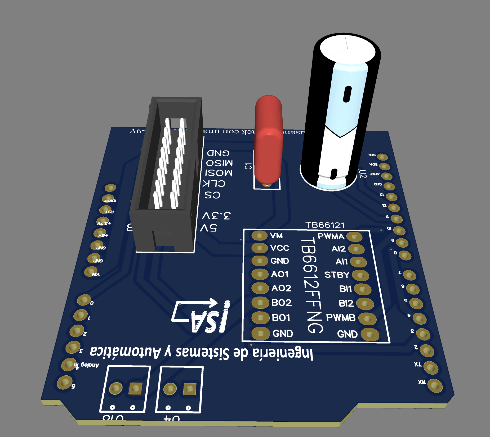

# PCB — Shield Arduino Motor CC / DC Motor Arduino Shield

  

## Descripción / Description

Shield diseñado a medida para Arduino UNO que integra en una sola placa el driver de motor y el conector del encoder, eliminando el cableado volante y haciendo el montaje completamente plug & play.

*Custom Arduino UNO shield integrating the motor driver and encoder connector on a single board, eliminating loose wiring for a fully plug-and-play assembly.*

---

## Componentes integrados / Integrated components

| Ref | Componente | Valor | Función |
|---|---|---|---|
| TB66121 | **Toshiba TB6612FNG** | — | Driver DC motor — 1.2 A cont. / 3 A pico |
| C1 | Condensador film CBB | **100 nF (0.1 µF), 250 V** | Desacoplo de la alimentación lógica |
| U2 | Condensador electrolítico | **10 µF** (Rubycon 420BXC10MEFC10X20, Ø10×20 mm) | Desacoplo de la alimentación VM del motor |
| CN1 | Conector 2×8 pines, paso 2.54 mm | — | Interfaz con encoder **ams AS5047P** (CS, CLK, MOSI, MISO, 3.3V, 5V, GND, GND) |
| U4, U18 | 2× bornera de tornillo (2 pines, paso 2.54 mm) | — | Salidas al motor (AO1/AO2 y BO1/BO2) |

## Conexiones al Arduino / Arduino connections

La placa se apila directamente sobre el Arduino UNO. Las señales de control quedan así:

| Señal | Pin Arduino | Descripción |
|---|---|---|
| PWMA | D9 | PWM del motor (Timer1, 31 250 Hz) |
| AIN1 | D7 | Dirección motor (bit 1) |
| AIN2 | D8 | Dirección motor (bit 2) |
| STBY | D6 | Standby driver (HIGH = activo) |
| CS encoder | D4 | Chip Select AS5047P (SPI) |
| SCK | D13 | Reloj SPI |
| MISO | D12 | Datos encoder → Arduino |
| MOSI | D11 | Datos Arduino → encoder |

## Alimentación / Power

- **VCC (lógica):** 5 V desde el propio Arduino
- **VM (motor):** alimentación externa 9–12 V (bornera o pin VIN del Arduino con fuente externa)
- El condensador electrolítico en VM amortigua los transitorios de corriente del motor

## Archivos del diseño / Design files

| Archivo | Contenido |
|---|---|
| [`Schematic_Control_Motor_CC_2026-11-06.pdf`](Schematic_Control_Motor_CC_2026-11-06.pdf) | Esquemático completo |
| [`Gerber_Control_Motor_CC_PCB_Control_Motor_CC_2026-11-06.zip`](Gerber_Control_Motor_CC_PCB_Control_Motor_CC_2026-11-06.zip) | Archivos Gerber para fabricación |
| [`BOM_Control_Motor_CC_2026-11-06.csv`](BOM_Control_Motor_CC_2026-11-06.csv) | Lista de materiales (BOM) |
| [`OBJ_PCB_Control_Motor_CC_2026-11-06.zip`](OBJ_PCB_Control_Motor_CC_2026-11-06.zip) | Modelo 3D de la PCB (formato OBJ) |

> **Diseñado con:** [EasyEDA](https://easyeda.com)

## Notas de fabricación / Fabrication notes

- Placa de 2 capas, FR4
- Grosor de pista recomendado: ≥ 1 mm en las pistas de potencia (VM → motor)
- Compatible con servicios estándar de PCB (JLCPCB, PCBWay, etc.)
