# Software MATLAB — `MotorCC_V3`

<p align="center">
  <a href="#español">🇪🇸 Español</a> &nbsp;|&nbsp;
  <a href="#english">🇬🇧 English</a>
</p>

---

<a name="español"></a>
## Español

Este directorio contiene los archivos de software necesarios para controlar el motor desde
MATLAB/Simulink. El modelo **`MotorCC_V3`** está disponible en ocho versiones exportadas,
una por cada release de MATLAB soportado.

**Requisito único:** MATLAB con **Instrument Control Toolbox**.
No se necesitan otras toolboxes (ni Control System, ni Simulink Real-Time, ni similares).

### Versiones disponibles

Abre el archivo que coincide con tu versión de MATLAB (o la más cercana por debajo):

| Archivo | MATLAB mínimo | MATLAB máximo recomendado |
|---------|--------------|---------------------------|
| `MotorCC_V3_R2025b.slx` | R2025b | *(versión de trabajo — la más reciente)* |
| `MotorCC_V3_R2024b.slx` | R2024b | R2025a |
| `MotorCC_V3_R2024a.slx` | R2024a | R2024a |
| `MotorCC_V3_R2023b.slx` | R2023b | R2023b |
| `MotorCC_V3_R2023a.slx` | R2023a | R2023a |
| `MotorCC_V3_R2022b.slx` | R2022b | R2022b |
| `MotorCC_V3_R2021b.slx` | R2021b | R2021b |
| `MotorCC_V3_R2020b.slx` | R2020b | R2021a |

> **Archivo de trabajo:** `MotorCC_V3_R2025b.slx` es el modelo fuente. Cualquier modificación
> debe hacerse sobre él y luego propagarse a las versiones anteriores con `exportar_versiones.m`
> (ver [Scripts de utilidad](#scripts-de-utilidad)).

---

### Estructura del modelo

#### Nivel raíz

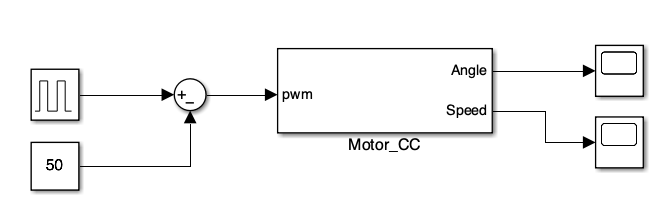

El nivel raíz es el **espacio de trabajo del estudiante**. Viene precargado con un ejemplo de
lazo abierto para verificar el funcionamiento antes de añadir ningún controlador:

| Bloque | Función en el ejemplo |
|--------|-----------------------|
| **Pulse Generator** | Genera una onda cuadrada de amplitud 50 y periodo 10 s (50 % de ciclo de trabajo) como señal de referencia |
| **Constant** | Valor de offset (50); junto con el Sum forma una referencia bipolar |
| **Sum** (`\|+-`) | Resta el offset a la referencia → señal de control de prueba |
| **Motor_CC** | Bloque con máscara que encapsula toda la comunicación con el Arduino (ver más abajo) |
| **Scope / Scope1** | Muestran en tiempo real el ángulo (°) y la velocidad (°/s) del eje |

> **Para cerrar el lazo:** el estudiante añade su bloque controlador (Gain, PID Controller,
> Transfer Fcn discreta…) entre la señal de referencia y la entrada de `Motor_CC`, y conecta
> la salida de ángulo o velocidad de vuelta al controlador como realimentación.

---

#### El bloque `Motor_CC` — vista exterior

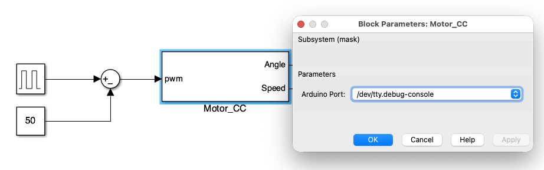

`Motor_CC` es un **subsistema con máscara** que presenta al exterior una interfaz de un solo
parámetro — el puerto serie del Arduino — y dos salidas: ángulo y velocidad.

Al hacer **doble clic** sobre el bloque se abre el diálogo de máscara con un **desplegable de
puertos disponibles** que se rellena automáticamente en ese momento (ver
[Cómo está construida la máscara](#cómo-está-construida-la-máscara--guía-de-reproducción)).

| Puerto | Dirección | Señal | Unidades |
|--------|-----------|-------|----------|
| Entrada | IN | Señal de control `u` | adimensional ∈ [−255, 255] |
| Salida 1 | OUT | Ángulo `θ` del eje | ° (acumulado, sin límites) |
| Salida 2 | OUT | Velocidad angular `ω` | °/s |

> **Ángulo acumulado:** el AS5047P entrega ángulo en [0°, 360°) por vuelta. El firmware
> Arduino cuenta las vueltas y acumula, de modo que `θ` crece (o decrece) indefinidamente —
> igual que un encoder incremental — sin saltos ni reinicios.

---

#### Interior del bloque `Motor_CC`

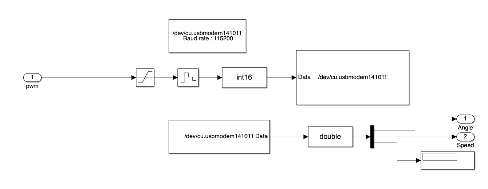

Dentro del subsistema hay **seis elementos**. El diagrama siguiente muestra el flujo completo
de señales y la función de cada bloque:

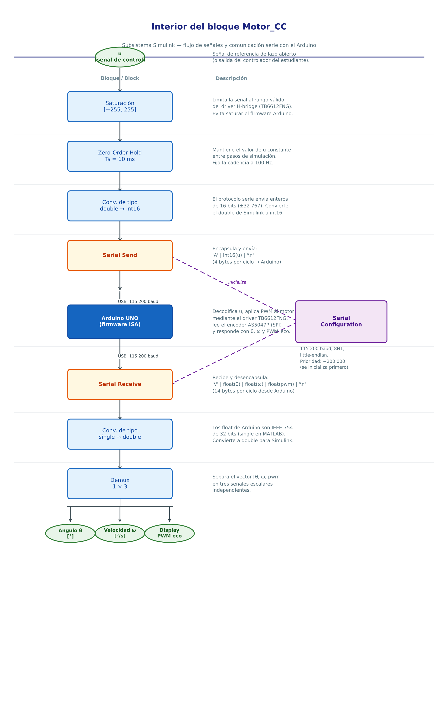

---

### Parámetros de los bloques del Instrument Control Toolbox

A continuación se detallan todos los parámetros que hay que configurar al crear o modificar
cada bloque. Estos valores son los que están guardados en `MotorCC_V3.slx`.

#### Serial Configuration

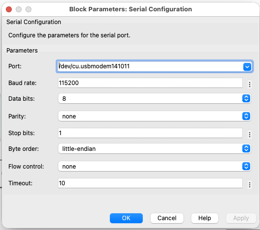

| Parámetro | Valor | Descripción |
|-----------|-------|-------------|
| **Port** | *(seleccionado por la máscara)* | Puerto serie del Arduino; se propaga automáticamente desde el desplegable del bloque `Motor_CC` |
| **Baud rate** | `115200` | Velocidad de comunicación; debe coincidir con el `Serial.begin(115200)` del firmware Arduino |
| **Data bits** | `8` | 8 bits por carácter (estándar) |
| **Parity** | `none` | Sin bit de paridad |
| **Stop bits** | `1` | Un bit de parada |
| **Byte order** | `little-endian` | El Arduino (arquitectura AVR/ARM) trabaja en little-endian; los `float` y `int16` se envían con el byte menos significativo primero |
| **Flow control** | `none` | Sin control de flujo hardware |
| **Timeout** | `10` s | Tiempo máximo de espera antes de error |
| **Priority** | `−200 000` | Valor negativo muy alto: garantiza que este bloque se inicialice antes que `Serial Send` y `Serial Receive`, que lo necesitan ya configurado |

#### Serial Send

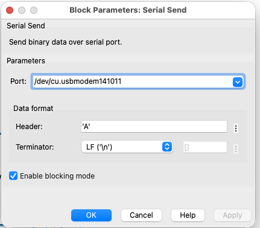

| Parámetro | Valor | Descripción |
|-----------|-------|-------------|
| **Port** | *(mismo que Serial Configuration)* | Se propaga desde la máscara |
| **Header** | `'A'` | Byte de cabecera; el firmware Arduino espera el carácter `'A'` para saber que llega un dato de control |
| **Terminator** | `LF ('\n')` | Byte de fin de mensaje; el firmware usa `readStringUntil('\n')` para detectar el final |
| **Enable blocking mode** | `on` | La ejecución de Simulink espera a que el byte se haya enviado antes de continuar — evita desbordamiento del buffer serie |
| **Priority** | `1` | Se ejecuta después de `Serial Configuration` (que tiene prioridad −200 000) |

**Cadena de datos enviada al Arduino:**

```
'A'  (1 byte, cabecera)
 u   (2 bytes, int16, little-endian)  ← señal de control ∈ [−255, 255]
'\n' (1 byte, terminador)
─────────────────────────────────────
Total: 4 bytes por ciclo (100 Hz → 400 bytes/s, muy por debajo de la capacidad del puerto)
```

#### Serial Receive

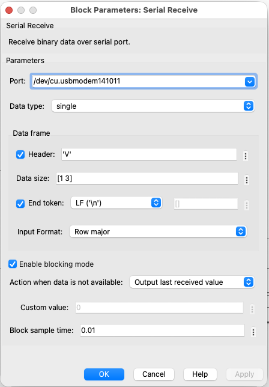

| Parámetro | Valor | Descripción |
|-----------|-------|-------------|
| **Port** | *(mismo que Serial Configuration)* | Se propaga desde la máscara |
| **Data type** | `single` | El Arduino envía los floats como `float` IEEE-754 de 32 bits; en MATLAB eso es `single` |
| **Header** | `'V'` | Byte de cabecera esperado; el firmware envía `'V'` antes de cada paquete de datos |
| **Data size** | `[1 3]` | Vector fila de 3 elementos: `[ángulo, velocidad, PWM_aplicado]` |
| **Terminator** | `LF ('\n')` | Fin de mensaje; el receptor busca `'\n'` para saber que el paquete está completo |
| **Input format** | `Row major` | Los 3 floats se reciben como una fila, en el orden en que el Arduino los escribe |
| **Enable blocking mode** | `on` | Simulink espera hasta recibir el paquete completo antes de avanzar al siguiente paso — mantiene el sincronismo a 100 Hz |
| **Action when data unavailable** | `Output last received value` | Si un ciclo no llega a tiempo, se repite el último valor válido en lugar de emitir un error |
| **Sample time** | `0.01` s | Ts = 10 ms → 100 Hz, igual que el Timer2 del Arduino |
| **Priority** | `1` | Mismo nivel que Serial Send |

**Paquete recibido desde el Arduino:**

```
'V'       (1 byte, cabecera)
ángulo    (4 bytes, float32 IEEE-754, little-endian)   [°]  acumulado
velocidad (4 bytes, float32 IEEE-754, little-endian)   [°/s]
PWM       (4 bytes, float32 IEEE-754, little-endian)   valor aplicado (eco)
'\n'      (1 byte, terminador)
──────────────────────────────────────────────────────────────────────
Total: 14 bytes por ciclo (100 Hz → 1 400 bytes/s)
```

---

### Cómo usar el modelo

1. Conectar el Arduino por USB.
2. Abrir `MotorCC_V3.slx` en MATLAB/Simulink.
3. **Seleccionar el puerto**: hacer doble clic en el bloque `Motor_CC` → el desplegable se
   rellena automáticamente con los puertos disponibles → seleccionar el que corresponde al
   Arduino → OK.
4. Pulsar **Run** (Ctrl+T o botón ▶). La simulación corre en tiempo real a 100 Hz.
5. Observar ángulo y velocidad en los Scopes durante la ejecución.
6. **Parar la simulación**: el modelo incluye un callback `StopFcn` que envía automáticamente
   `u = 0` al Arduino en el momento de pulsar Stop — el motor se detiene solo, sin intervención
   manual. Si por algún motivo el callback no llega a ejecutarse (crash de MATLAB, desconexión
   serie inesperada), el watchdog del firmware Arduino para el motor tras ≈ 100 ms sin recibir
   datos.

---

### Scripts de utilidad

#### `exportar_versiones.m`

Exporta `MotorCC_V3_R2025b.slx` a las siete versiones anteriores de MATLAB de forma automática.
Debe ejecutarse con **MATLAB R2025b** desde la carpeta `software/matlab/`:

```matlab
cd('<ruta>/Motor-CC-Control-Lab/software/matlab')
run('exportar_versiones.m')
```

El script usa `save_system(..., 'ExportToVersion', '<release>')` para cada versión de la lista.
Los archivos resultantes sobrescriben los existentes en la misma carpeta.

#### `set_stopfcn.m`

Inyecta el callback `StopFcn` en `MotorCC_V3_R2025b.slx`. Solo es necesario ejecutarlo
si se recrea el modelo desde cero o si el callback desaparece accidentalmente.
Después de ejecutarlo, volver a lanzar `exportar_versiones.m` para propagar el callback
a todas las versiones exportadas.

```matlab
cd('<ruta>/Motor-CC-Control-Lab/software/matlab')
run('set_stopfcn.m')         % añade StopFcn a R2025b
run('exportar_versiones.m')  % propaga a R2020b-R2024b
```

---

### Cómo está construida la máscara — guía de reproducción

Esta sección explica paso a paso cómo recrear la máscara del bloque `Motor_CC` desde cero.
Es útil si se quiere portar el modelo a otro proyecto o entender exactamente qué hace cada
ajuste.

#### Paso 1 — Abrir el editor de máscara

1. Clic derecho sobre el bloque `Motor_CC` en el nivel raíz.
2. En el menú contextual: **Mask → Edit Mask…**
3. Se abre la ventana **Mask Editor: Motor_CC** con cuatro pestañas:
   *Parameters & Dialog*, *Code*, *Constraints* e *Icon*.

#### Paso 2 — Crear el parámetro `PortName` (pestaña *Parameters & Dialog*)

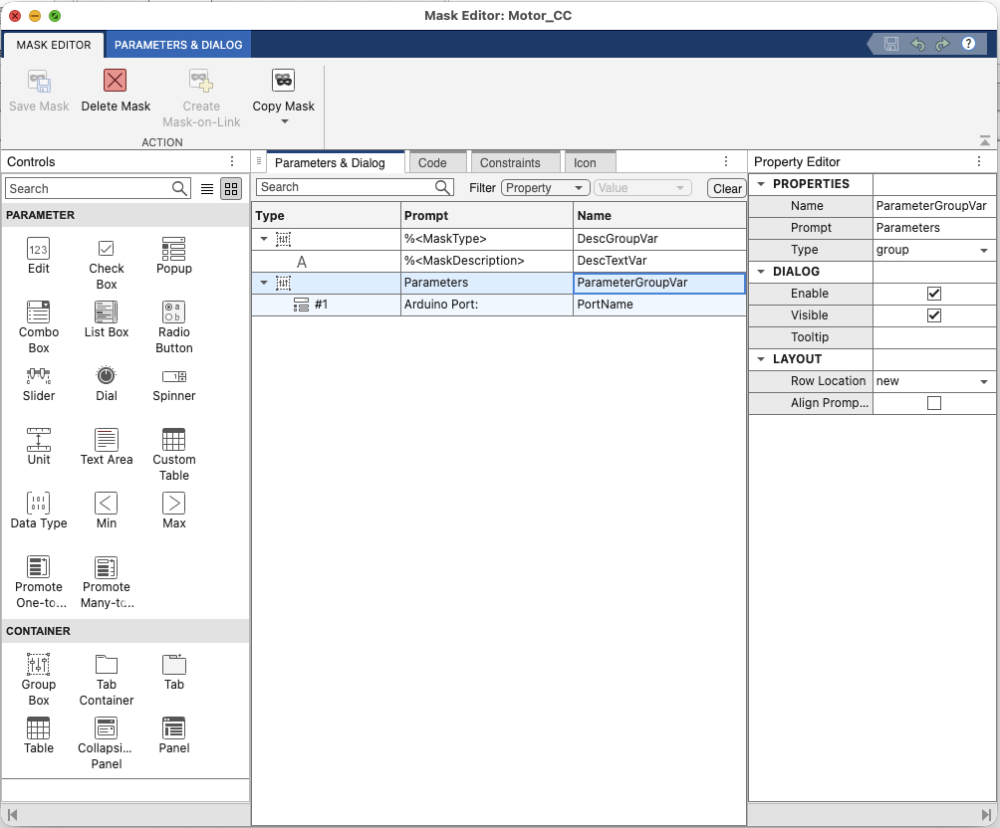

1. Haz clic en la pestaña **Parameters & Dialog**.
2. En el panel izquierdo (*Controls*) arrastra un control **Popup** al área central.
   Simulink crea una nueva fila en la tabla.
3. Configura sus propiedades en el *Property Editor* (panel derecho):

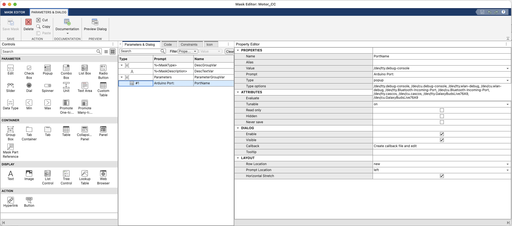

| Propiedad | Valor | Por qué |
|-----------|-------|---------|
| **Name** | `PortName` | Nombre exacto de la variable MATLAB que el `OpenFcn` modifica con `get/set_param` y `TypeOptions` |
| **Prompt** | `Arduino Port:` | Texto que ve el usuario en el diálogo de máscara |
| **Type** | `popup` | Muestra un desplegable; el `OpenFcn` rellena sus opciones en tiempo real |
| **Value** | *(cualquiera)* | El `OpenFcn` lo sobreescribe al abrir; el valor guardado no importa |
| **Tunable** | `on` | Permite cambiar el puerto mientras la simulación está parada sin necesidad de recompilar |
| **Evaluate** | *(vacío)* | El valor se trata como cadena de texto, no se evalúa como expresión MATLAB |

> **Sobre el campo *Type Options*:** la captura muestra la lista de puertos que tenía el
> ordenador la última vez que se ejecutó el `OpenFcn`. Al crear la máscara desde cero, ese
> campo puede dejarse con cualquier valor de ejemplo (p. ej. `COM1`). El `OpenFcn` lo
> sobreescribirá automáticamente en tiempo real cada vez que se abra el diálogo — no hace
> falta rellenarlo a mano.

4. Haz clic en **Save Mask** para guardar los cambios.

#### Paso 3 — La pestaña *Code* del Mask Editor **no** es donde va el `OpenFcn`

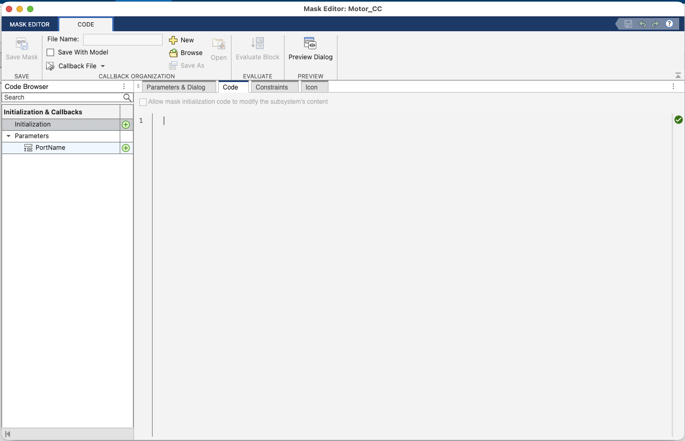

Este es el error más habitual. La pestaña **Code** del Mask Editor contiene el
*Initialization code* de la máscara (código que se ejecuta al compilar el modelo, antes
de la simulación). El `OpenFcn` **no va aquí**.

El `OpenFcn` es un *callback de bloque*, no de máscara, y se configura en un lugar
completamente distinto (ver paso siguiente).

#### Paso 4 — Añadir el `OpenFcn` en las propiedades del bloque

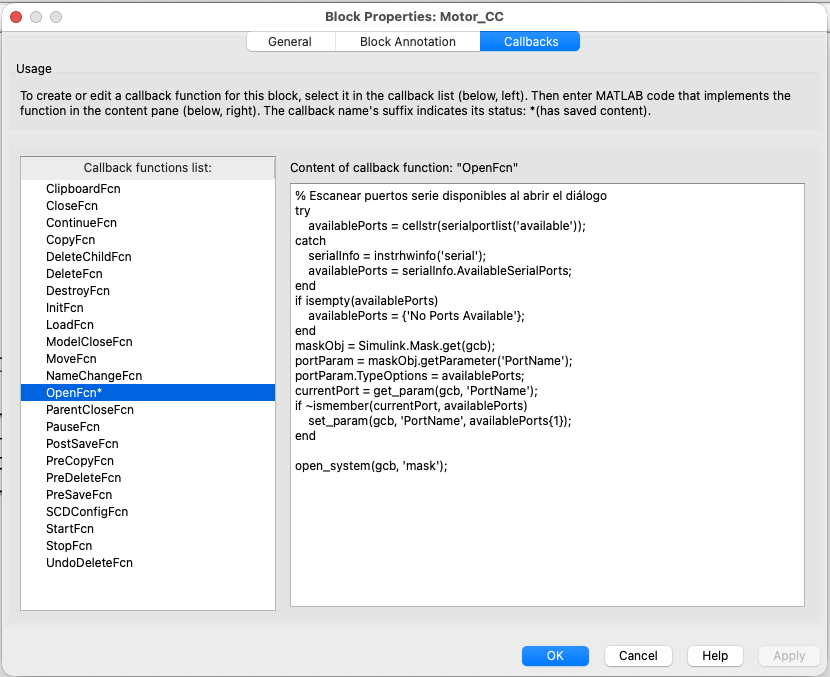

1. Cierra el Mask Editor (o déjalo abierto, no importa).
2. Clic derecho sobre el bloque `Motor_CC` → **Properties…**
   *(cuidado: no "Mask → Edit Mask", sino "Properties" a secas)*
3. Se abre **Block Properties: Motor_CC**. Ve a la pestaña **Callbacks**.
4. En la lista de la izquierda (*Callback functions list*) selecciona **`OpenFcn`**.
   El asterisco `*` al lado del nombre indica que ya tiene código guardado.
5. En el panel derecho (*Content of callback function: "OpenFcn"*) pega el siguiente código:

```matlab
% Escanear puertos serie disponibles al abrir el diálogo
try
    availablePorts = cellstr(serialportlist('available'));
catch
    serialInfo = instrhwinfo('serial');
    availablePorts = serialInfo.AvailableSerialPorts;
end
if isempty(availablePorts)
    availablePorts = {'No Ports Available'};
end
maskObj = Simulink.Mask.get(gcb);
portParam = maskObj.getParameter('PortName');
portParam.TypeOptions = availablePorts;
currentPort = get_param(gcb, 'PortName');
if ~ismember(currentPort, availablePorts)
    set_param(gcb, 'PortName', availablePorts{1});
end

open_system(gcb, 'mask');
```

6. Haz clic en **OK**. Guarda el modelo (`Ctrl+S`).

> **Por qué `open_system(gcb, 'mask')` es obligatorio:**
> el `OpenFcn` *sustituye* al comportamiento por defecto del doble clic. Si no se llama
> explícitamente a `open_system`, el diálogo de máscara nunca aparece.

**Explicación línea a línea del código:**

| Bloque de código | Por qué está ahí |
|-----------------|-----------------|
| `try … serialportlist('available') … catch … instrhwinfo` | `serialportlist` es la API moderna (R2020b en adelante). En versiones anteriores no existe y lanza un error; el `catch` cae a la API antigua `instrhwinfo` para garantizar compatibilidad hacia atrás |
| `if isempty(availablePorts)` | Si no hay ningún Arduino conectado, el desplegable no puede quedar vacío (Simulink lo rechaza); se rellena con el texto `'No Ports Available'` como aviso |
| `maskObj.getParameter('PortName').TypeOptions = availablePorts` | Actualiza **en tiempo real** las opciones del desplegable con los puertos detectados en ese momento — así el usuario siempre ve la lista actual, no la que había cuando se guardó el modelo |
| `if ~ismember(currentPort, availablePorts)` | Si el puerto guardado en el modelo ya no existe (porque se desenchufó el Arduino o cambió el nombre del puerto), selecciona automáticamente el primero disponible en lugar de dejar una opción inválida |
| `open_system(gcb, 'mask')` | Abre el diálogo de máscara propiamente dicho; esta línea es obligatoria porque el `OpenFcn` sustituye al comportamiento por defecto — sin ella el doble clic no abriría nada |

#### Por qué propagar el puerto fue tan complicado

Los bloques del Instrument Control Toolbox (`Serial Configuration`, `Serial Send`,
`Serial Receive`) guardan el puerto en **tres nombres de parámetro distintos** según la
versión de MATLAB (`PortSel`, `Port` y `ComPort`), y **ninguno de ellos acepta directamente
una variable del workspace de la máscara** — a diferencia de bloques nativos de Simulink
que sí resuelven variables de máscara en sus campos.

La solución adoptada:

1. La máscara expone **un único parámetro** (`PortName`, tipo `popup`).
2. El `OpenFcn` actualiza las opciones de ese desplegable con los puertos reales del sistema
   justo antes de que el usuario vea el diálogo.
3. Cuando el usuario selecciona un puerto y pulsa **OK**, Simulink propaga el valor de
   `PortName` a los bloques interiores a través de la configuración de la máscara.

Para que esta propagación funcione en todas las versiones fue necesario:
- Nombrar el parámetro de máscara exactamente `PortName` (el nombre que los bloques ICT
  buscan internamente según la versión).
- Verificar el comportamiento en cada versión de MATLAB disponible en el laboratorio.
- Usar `portParam.TypeOptions` en lugar de `set_param` directo, porque la asignación
  directa falla cuando el valor aún no está entre las opciones del desplegable.

---

<br>

---

<p align="center">
  🇬🇧 &nbsp;&nbsp; <strong>E N G L I S H</strong> &nbsp;&nbsp; 🇬🇧
</p>

---

<a name="english"></a>
## English

This directory contains the software files needed to control the motor from
MATLAB/Simulink. The **`MotorCC_V3`** model is available in eight exported versions,
one per supported MATLAB release.

**Single requirement:** MATLAB with the **Instrument Control Toolbox**.
No other toolboxes needed (no Control System, Simulink Real-Time, or similar).

### Available versions

Open the file that matches your MATLAB version (or the closest one below):

| File | Minimum MATLAB | Recommended up to |
|------|---------------|-------------------|
| `MotorCC_V3_R2025b.slx` | R2025b | *(working file — most recent)* |
| `MotorCC_V3_R2024b.slx` | R2024b | R2025a |
| `MotorCC_V3_R2024a.slx` | R2024a | R2024a |
| `MotorCC_V3_R2023b.slx` | R2023b | R2023b |
| `MotorCC_V3_R2023a.slx` | R2023a | R2023a |
| `MotorCC_V3_R2022b.slx` | R2022b | R2022b |
| `MotorCC_V3_R2021b.slx` | R2021b | R2021b |
| `MotorCC_V3_R2020b.slx` | R2020b | R2021a |

> **Working file:** `MotorCC_V3_R2025b.slx` is the source model. Any changes must be made
> there first and then propagated to older versions with `exportar_versiones.m`
> (see [Utility scripts](#utility-scripts)).

---

### Model structure

#### Root level


The root level is the **student's workspace**. It ships with an open-loop test example to
verify communication before adding any controller:

| Block | Role in the example |
|-------|---------------------|
| **Pulse Generator** | Square wave, amplitude 50, period 10 s, 50 % duty cycle — test reference signal |
| **Constant** | Offset value (50); forms a bipolar reference together with Sum |
| **Sum** (`\|+-`) | Subtracts the offset from the reference → test control signal |
| **Motor_CC** | Masked subsystem encapsulating all Arduino communication (see below) |
| **Scope / Scope1** | Real-time display of shaft angle (°) and velocity (°/s) |

> **To close the loop:** the student adds their controller block (Gain, PID Controller,
> discrete Transfer Fcn…) between the reference signal and `Motor_CC`'s input, and connects
> the angle or speed output back to the controller as feedback.

---

#### The `Motor_CC` block — external view


`Motor_CC` is a **masked subsystem** that presents a single-parameter interface to the
outside — the Arduino serial port — and two outputs: angle and velocity.

**Double-clicking** the block opens the mask dialog with an **auto-populated port dropdown**
(see [How the mask is built](#how-the-mask-is-built--reproduction-guide)).

| Port | Direction | Signal | Units |
|------|-----------|--------|-------|
| Input | IN | Control signal `u` | dimensionless ∈ [−255, 255] |
| Output 1 | OUT | Shaft angle `θ` | ° (accumulated, unbounded) |
| Output 2 | OUT | Angular velocity `ω` | °/s |

> **Accumulated angle:** the AS5047P delivers angle in [0°, 360°) per revolution. The Arduino
> firmware counts full revolutions and accumulates, so `θ` grows (or decreases) indefinitely —
> exactly like an incremental encoder — with no jumps or resets.

---

#### Inside the `Motor_CC` block


Inside the subsystem there are **six elements**. The diagram below shows the complete signal
flow and the role of each block:

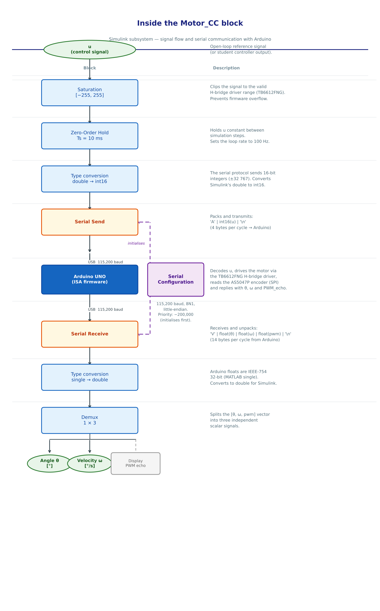

---

### Instrument Control Toolbox block parameters

#### Serial Configuration


| Parameter | Value | Notes |
|-----------|-------|-------|
| **Port** | *(set by mask)* | Arduino serial port; propagated automatically from the `Motor_CC` dropdown |
| **Baud rate** | `115200` | Must match `Serial.begin(115200)` in the Arduino firmware |
| **Data bits** | `8` | Standard 8-bit framing |
| **Parity** | `none` | No parity bit |
| **Stop bits** | `1` | One stop bit |
| **Byte order** | `little-endian` | AVR/ARM is little-endian; floats and int16 are sent LSB first |
| **Flow control** | `none` | No hardware flow control |
| **Timeout** | `10` s | Maximum wait before error |
| **Priority** | `−200,000` | Very high negative priority ensures this block initialises before Serial Send and Serial Receive, which depend on it |

#### Serial Send


| Parameter | Value | Notes |
|-----------|-------|-------|
| **Port** | *(same as Serial Configuration)* | Propagated from mask |
| **Header** | `'A'` | Arduino firmware waits for `'A'` as the control-data start marker |
| **Terminator** | `LF ('\n')` | Firmware uses `readStringUntil('\n')` to detect end of message |
| **Enable blocking mode** | `on` | Simulink waits for the byte to be transmitted before proceeding — prevents serial buffer overflow |
| **Priority** | `1` | Runs after Serial Configuration (priority −200,000) |

**Packet sent to Arduino — 4 bytes per cycle at 100 Hz:**

```
'A'   1 byte  — header
 u    2 bytes — int16, little-endian, ∈ [−255, 255]
'\n'  1 byte  — terminator
```

#### Serial Receive


| Parameter | Value | Notes |
|-----------|-------|-------|
| **Port** | *(same as Serial Configuration)* | Propagated from mask |
| **Data type** | `single` | Arduino sends IEEE-754 32-bit floats; MATLAB `single` matches exactly |
| **Header** | `'V'` | Firmware sends `'V'` before each data packet |
| **Data size** | `[1 3]` | Row vector of 3 elements: [angle, speed, PWM_echo] |
| **Terminator** | `LF ('\n')` | Marks end of packet |
| **Input format** | `Row major` | 3 floats received in the order the Arduino writes them |
| **Enable blocking mode** | `on` | Simulink waits for the full packet before advancing — maintains 100 Hz synchronisation |
| **Action when data unavailable** | `Output last received value` | If a cycle arrives late, the last valid value is repeated instead of raising an error |
| **Sample time** | `0.01` s | Ts = 10 ms = 100 Hz, matches the Arduino Timer2 interrupt |
| **Priority** | `1` | Same level as Serial Send |

**Packet received from Arduino — 14 bytes per cycle at 100 Hz:**

```
'V'        1 byte  — header
angle      4 bytes — float32, little-endian  [°]
speed      4 bytes — float32, little-endian  [°/s]
PWM_echo   4 bytes — float32, little-endian  (applied PWM, echoed back)
'\n'       1 byte  — terminator
```

---

### How to use the model

1. Connect the Arduino via USB.
2. Open `MotorCC_V3.slx` in MATLAB/Simulink.
3. **Select the port**: double-click the `Motor_CC` block → the dropdown auto-populates with
   available ports → select the Arduino port → OK.
4. Press **Run** (Ctrl+T or the ▶ button). The simulation runs in real time at 100 Hz.
5. Watch angle and velocity on the Scopes during execution.
6. **Stop the simulation**: the model includes a `StopFcn` callback that automatically sends
   `u = 0` to the Arduino the moment Stop is pressed — the motor stops on its own, with no
   manual action needed. If for any reason the callback does not execute (MATLAB crash,
   unexpected serial disconnect), the Arduino firmware watchdog stops the motor after
   approx. 100 ms without receiving data.

---

### Utility scripts

#### `exportar_versiones.m`

Exports `MotorCC_V3_R2025b.slx` to the seven earlier MATLAB versions automatically.
Must be run with **MATLAB R2025b** from the `software/matlab/` folder:

```matlab
cd('<path>/Motor-CC-Control-Lab/software/matlab')
run('exportar_versiones.m')
```

The script uses `save_system(..., 'ExportToVersion', '<release>')` for each version in the list.
Output files overwrite the existing ones in the same folder.

#### `set_stopfcn.m`

Injects the `StopFcn` callback into `MotorCC_V3_R2025b.slx`. Only needed if the model is
rebuilt from scratch or the callback is accidentally lost. After running it, re-run
`exportar_versiones.m` to propagate the callback to all exported versions.

```matlab
cd('<path>/Motor-CC-Control-Lab/software/matlab')
run('set_stopfcn.m')         % add StopFcn to R2025b
run('exportar_versiones.m')  % propagate to R2020b-R2024b
```

---

### How the mask is built — reproduction guide

This section explains step by step how to recreate the `Motor_CC` block mask from scratch.
Useful for porting the model to another project or understanding exactly what each setting does.

#### Step 1 — Open the Mask Editor

1. Right-click the `Motor_CC` block at root level.
2. In the context menu: **Mask → Edit Mask…**
3. The **Mask Editor: Motor_CC** window opens with four tabs:
   *Parameters & Dialog*, *Code*, *Constraints* and *Icon*.

#### Step 2 — Create the `PortName` parameter (*Parameters & Dialog* tab)


1. Click the **Parameters & Dialog** tab.
2. In the left panel (*Controls*) drag a **Popup** control into the central table area.
   Simulink creates a new row.
3. Set its properties in the *Property Editor* (right panel):


| Property | Value | Why |
|----------|-------|-----|
| **Name** | `PortName` | Exact variable name the `OpenFcn` reads and writes via `get/set_param` and `TypeOptions` |
| **Prompt** | `Arduino Port:` | Label shown to the user in the mask dialog |
| **Type** | `popup` | Renders a dropdown; the `OpenFcn` fills its options at runtime |
| **Value** | *(anything)* | Overwritten by `OpenFcn` when the dialog opens; the saved value does not matter |
| **Tunable** | `on` | Allows changing the port without recompiling while the simulation is stopped |
| **Evaluate** | *(empty)* | Value is treated as a plain string, not evaluated as a MATLAB expression |

> **About the *Type Options* field:** the screenshot shows the port list that was on the
> computer the last time the `OpenFcn` ran. When creating the mask from scratch, that field
> can be left with any placeholder value (e.g. `COM1`). The `OpenFcn` overwrites it
> automatically at runtime every time the dialog opens — you never need to fill it in manually.

4. Click **Save Mask**.

#### Step 3 — The Mask Editor *Code* tab is **not** where the `OpenFcn` goes


This is the most common mistake. The **Code** tab of the Mask Editor holds the mask's
*Initialization code* — code that runs at model compile time, before simulation starts.
The `OpenFcn` does **not** go here.

The `OpenFcn` is a *block callback*, not a mask callback, and it is configured in a
completely different place (see next step).

#### Step 4 — Add the `OpenFcn` in the block properties


1. Close the Mask Editor (or leave it open, it does not matter).
2. Right-click the `Motor_CC` block → **Properties…**
   *(careful: not "Mask → Edit Mask" — just "Properties")*
3. **Block Properties: Motor_CC** opens. Go to the **Callbacks** tab.
4. In the left list (*Callback functions list*) select **`OpenFcn`**.
   The asterisk `*` next to the name means it already has saved code.
5. In the right panel (*Content of callback function: "OpenFcn"*) paste the following code:

```matlab
% Scan available serial ports when the dialog opens
try
    availablePorts = cellstr(serialportlist('available'));
catch
    serialInfo = instrhwinfo('serial');
    availablePorts = serialInfo.AvailableSerialPorts;
end
if isempty(availablePorts)
    availablePorts = {'No Ports Available'};
end
maskObj = Simulink.Mask.get(gcb);
portParam = maskObj.getParameter('PortName');
portParam.TypeOptions = availablePorts;
currentPort = get_param(gcb, 'PortName');
if ~ismember(currentPort, availablePorts)
    set_param(gcb, 'PortName', availablePorts{1});
end

open_system(gcb, 'mask');
```

6. Click **OK**. Save the model (`Ctrl+S`).

> **Why `open_system(gcb, 'mask')` is mandatory:**
> the `OpenFcn` *replaces* the default double-click behaviour. Without explicitly calling
> `open_system`, the mask dialog never appears.

**Line-by-line explanation:**

| Code | Why it is there |
|------|----------------|
| `try … serialportlist … catch … instrhwinfo` | `serialportlist` is the modern API (R2020b+). Older MATLAB versions do not have it and throw an error; the `catch` falls back to the legacy `instrhwinfo` API for backwards compatibility |
| `if isempty(availablePorts)` | If no Arduino is connected, the dropdown cannot be left empty (Simulink rejects it); a placeholder string is inserted as a warning |
| `portParam.TypeOptions = availablePorts` | Updates the dropdown options **live** with the ports currently connected — the user always sees the real list, not whatever was saved with the model |
| `if ~ismember(currentPort, availablePorts)` | If the saved port no longer exists (Arduino unplugged or OS renamed it), the first available port is selected automatically instead of leaving an invalid option |
| `open_system(gcb, 'mask')` | Opens the mask dialog itself — this line is **mandatory** because the `OpenFcn` replaces the default double-click behaviour; without it nothing would open |

#### Why port propagation was so hard

The Instrument Control Toolbox blocks (`Serial Configuration`, `Serial Send`,
`Serial Receive`) store the port name under **three different parameter names** depending
on the installed MATLAB version: `PortSel` (old), `Port` (mid), `ComPort` (recent).
None of these parameters resolves mask workspace variables the way native Simulink blocks do.

The solution:

1. The mask exposes **one single parameter** (`PortName`, type `popup`).
2. The `OpenFcn` updates that dropdown's options with the system's real ports
   right before the user sees the dialog.
3. When the user picks a port and clicks **OK**, Simulink propagates `PortName`'s value
   to the interior blocks through the mask configuration.

To make propagation reliable across all MATLAB versions it was necessary to:
- Name the mask parameter exactly `PortName` (the name ICT blocks look for internally,
  depending on the version).
- Verify the behaviour on every MATLAB version available in the lab.
- Use `portParam.TypeOptions` instead of a direct `set_param`, because direct assignment
  fails when the value is not yet among the dropdown's options.
